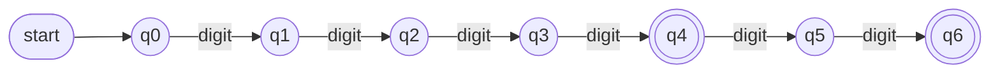
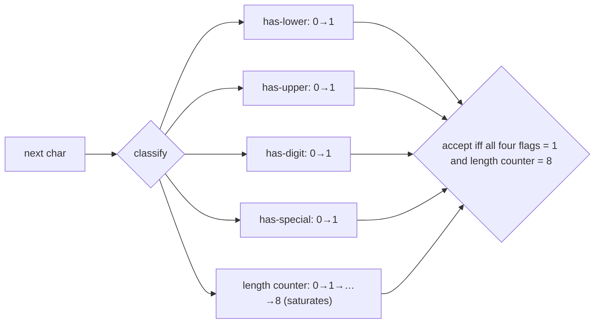
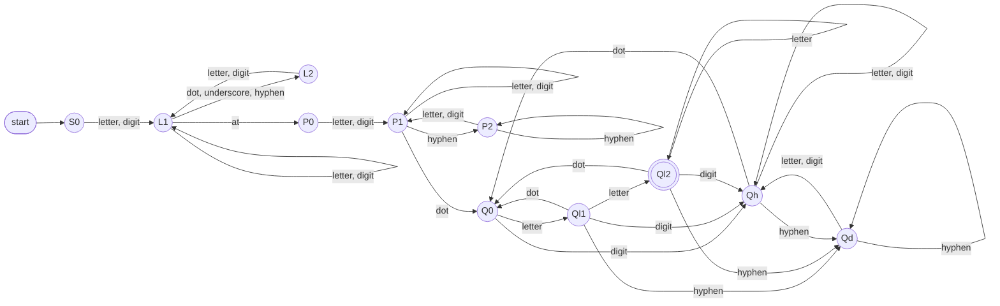

# Task 2 – Designing Automata for Real-Time Applications

**Course:** 21CSC301T Formal Language and Automata · **CLA-2, Assessment Task 2** · CO1, CO2, CO3 · SDG 9

Three validators are modelled as DFAs: **ATM PIN**, **password policy** and **e-mail format**.
Each section gives the alphabet, the formal language, the automaton, a transition explanation,
≥ 5 accepted and ≥ 5 rejected strings, and limitations. Every claim below is checked by
`tests/test_task2.py` (listed cases, DFA ≡ regex fuzzing on 20 000 random strings each, state counts).

> **Convention.** Transitions are drawn over *symbol classes* (`digit`, `letter`, …) instead of 95 individual
> characters. Any transition not drawn goes to an implicit non-accepting **dead (trap) state**.

---

## 1. ATM PIN verification

**Rule.** A PIN is exactly 4 or 6 ASCII digits.
**Alphabet.** Σ = {0,…,9} (class `digit`); every other character is "other" → dead.
**Language.** L<sub>PIN</sub> = { w ∈ Σ\* : |w| ∈ {4, 6} } &nbsp;≡&nbsp; regex `[0-9]{4}([0-9]{2})?`
**Formal DFA.** M = (Q, Σ, δ, q0, F) with Q = {q0,…,q6, dead}, δ(qᵢ, digit) = qᵢ₊₁ (i < 6), F = {q4, q6}.


*State qᵢ = "i digits read so far". q4 and q6 accept; a 7th digit or any non-digit goes to dead.*

| Accepted | Why | Rejected | Why |
|---|---|---|---|
| `1234` | 4 digits → q4 | `` (empty) | stays in q0 (non-accepting) |
| `0000` | leading zeros are legal digits | `123` | ends in q3 |
| `4821` | 4 digits | `12345` | ends in q5 |
| `987654` | 6 digits → q6 | `1234567` | 7th digit → dead |
| `000007` | 6 digits | `12a4` / `12 34` / `-123` | non-digit → dead |
| | | `١٢٣٤` (Arabic-Indic) | not ASCII digits → dead |

Minimal DFA: 7 states + dead = **8** (`DFA.minimal_state_count()`), so the design is already minimal.

## 2. Password verification

**Rule.** ≥ 8 printable-ASCII characters (no spaces / non-ASCII) containing at least one lowercase, one uppercase, one digit and one special character.
**Alphabet (classes).** `lower`, `upper`, `digit`, `special` (= `string.punctuation`); `other` → dead.
**Language.** L<sub>PW</sub> = { w ∈ Σ\* : |w| ≥ 8 ∧ w has all four classes }.

**Construction (product automaton).** A password DFA is the product of five tiny machines run in parallel:



State = `(min(len, 8), 4-bit class mask)` ⇒ 9 × 16 = 144 possible, **104 reachable**, **77 after minimisation** (incl. dead).
Full diagram: [`docs/diagrams/password_dfa.svg`](../docs/diagrams/password_dfa.svg) (generated, zoomable).

| Accepted | Rejected | Reason for rejection |
|---|---|---|
| `Passw0rd!` | `password` | no upper/digit/special |
| `Abcdef1@x` | `PASSWORD1!` | no lowercase |
| `Zz9#Zz9#` (exactly 8) | `Pass1!` | length 6 < 8 |
| `correct-Horse-9-battery` | `Password!!` | no digit |
| `P@ssw0rdP@ss` | `Passw0rd12` | no special |
| | `Passw0rd 1!` / `Pässw0rd!` | space / non-ASCII → dead |

*Design choice:* a maximum length (e.g. 64) is also regular but multiplies the state count (length counter up to 64 × 16 masks); real systems enforce it with a plain length check.

## 3. E-mail format validation

**Rule (simplified RFC 5322 subset).**
`local = alnum+ ([._-] alnum+)*` · `domain = (label '.')+ tld` · `label = alnum+ ('-'+ alnum+)*` · `tld = [A-Za-z]{2,}`
**Language.** L<sub>mail</sub> = L(`local @ domain`) — regex `[A-Za-z0-9]+([._-][A-Za-z0-9]+)*@([A-Za-z0-9]+(-+[A-Za-z0-9]+)*\.)+[A-Za-z]{2,}`.
**Classes.** `letter, digit, dot, underscore, hyphen, at`.



| State | Meaning |
|---|---|
| S0 | nothing read |
| L1 / L2 | local part: last char alphanumeric / last char a separator (`.` `_` `-`) |
| P0 / P1 / P2 | domain, **before any dot**: just after `@` / last char alnum / last char `-` |
| Q0 | just after a dot (a label must start) |
| Ql1 / **Ql2** | current label is letters-only with 1 / ≥ 2 letters (**Ql2 = accepting**: a valid TLD) |
| Qh / Qd | current label contains a digit or hyphen (not a TLD) / last char is `-` |

Why it works: `..`, a leading/trailing separator, `@-`, `-.`, a missing dot, a one-letter or digit-bearing TLD all lead to dead or a non-accepting state.
Generated diagram (identical machine): [`docs/diagrams/email_dfa.png`](../docs/diagrams/email_dfa.png).

| Accepted | Rejected | Reason |
|---|---|---|
| `user@example.com` | `user@example` | no dot in domain (stuck in P1) |
| `first.last@mail.srmist.edu.in` | `user@.com` | dot right after `@` |
| `a_b-c@x1.org` | `@example.com` | empty local part |
| `student123@srm-trichy.ac.in` | `user..name@example.com` | two separators in a row |
| `A@b.co` | `.user@example.com` | leading separator |
| | `user@exam_ple.com` | `_` not allowed in domain |
| | `user@example.c` / `user@example.c0m` | TLD too short / has digit |
| | `user name@…`, `user@@…`, `user@-example.com`, `user@example-.com` | space, 2 × `@`, hyphen at label edge |

The hand-designed machine has 11 reachable states; **minimisation merges P1≡Qh and P2≡Qd → 9 states (incl. dead)** — a useful observation: the "before-first-dot" and "has-digit" situations behave identically for the future.

---

## Design comparison

| Aspect | DFA | Regex | NFA |
|---|---|---|---|
| Matching time | O(n), one table lookup per char | O(n) if compiled to a DFA; backtracking engines can blow up | O(n·\|Q\|) simulation |
| Readability | diagram, easy to prove correct | shortest to write | shortest diagrams |
| Size risk | product constructions grow multiplicatively (password: 104 states) | lookaheads (`(?=…)`) are *not* regular syntax but a convenient shorthand | NFA for "contains all 4 classes" is smaller, but determinising it gives the same product |

The automaton and regex of each validator were cross-checked on random strings (`tests/test_task2.py`) — this is how the DFAs were validated.

## Syntax vs semantic rules (`semantic_layer.py`)

| Application | Regular / syntactic (finite automaton is enough) | Semantic / business (extra processing needed) |
|---|---|---|
| ATM PIN | exactly 4 or 6 digits | `0000`/`1234` too weak, equals the card's stored PIN (constant-time compare), 3-attempt lockout counter |
| Password | length + 4 character classes | contains username, in a breached/common list, reuse of old passwords |
| E-mail | well-formed `local@domain` | does the domain exist (DNS/MX)? does the mailbox exist? disposable domain? — needs a confirmation e-mail |

A **finite automaton is sufficient** when the rule depends only on a bounded amount of memory about the prefix (counters up to a constant, flags). It is **not sufficient** when the rule needs unbounded counting/matching (nested structure, "n opens = n closes", Task 3), comparison with stored data, a history of attempts, or external look-ups.

## Model limitations
* Only a **subset** of real syntax: no quoted local parts, IP-literal domains, `+` tags or internationalised (Unicode) addresses; a 4-or-6-digit PIN policy is bank-specific.
* DFAs decide *format*, never *truth* (existence of a mailbox, ownership of a PIN).
* Pure ASCII assumption — non-ASCII letters/digits are deliberately rejected (see tests).
* Password product automaton grows with every added rule (state explosion); policy checks beyond "count/flags" are done outside the DFA.

## Run
```bash
python run_demo.py                 # transition traces + syntax/semantic demo
python -m pytest tests/test_task2.py -v
python make_diagrams.py            # regenerates docs/diagrams/*
```
