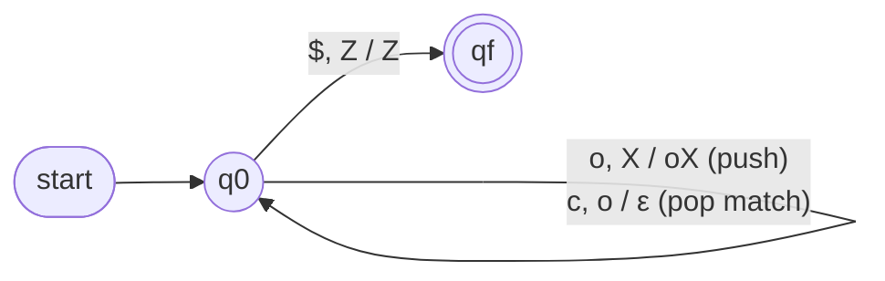
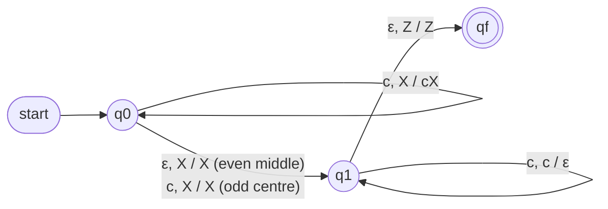
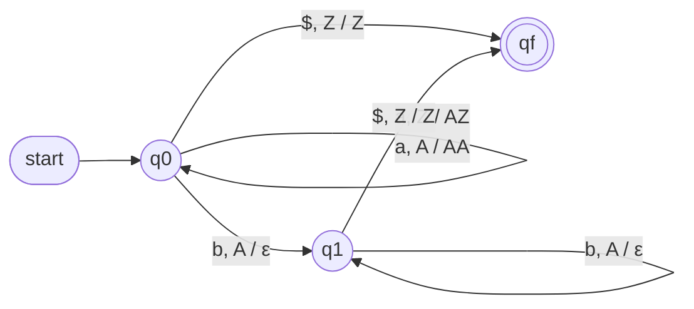

# Task 3 – Case-Study Analysis and Design using PDA and CFG

**Course:** 21CSC301T Formal Language and Automata · **CLA-2, Assessment Task 3** · CO2, CO3, CO4 · SDG 9

Four case studies: **(1) balanced brackets, (2) palindromes, (3) arithmetic expressions, (4) aⁿbⁿ** (the minimal "why not a
finite automaton" example). For each: target language → CFG → PDA → derivations / stack moves → ambiguity & determinism →
accepted and rejected strings. Everything is executable (`fla/cfg.py`, `fla/pda.py`) and verified by `tests/test_task3.py`,
which compares the CFG, the PDA and an independent reference on **every string up to length 8**.

**Notation.** PDA = (Q, Σ, Γ, δ, q0, Z, F). An instantaneous description is (state, remaining input, ⟨stack⟩), top of stack on the left, `⊢` = one move.
DPDAs read `input$` (end-marker) so that acceptance by final state stays deterministic.

---

## Why finite automata are insufficient
Matching nested/paired structure needs **unbounded memory**. Pumping-lemma proof for L = {aⁿbⁿ}: assume a DFA with *p* states;
read aᵖ — by pigeonhole two prefixes aⁱ, aʲ (i < j ≤ p) reach the **same state**, so aⁱbⁱ and aʲbⁱ get the **same verdict**, yet only aⁱbⁱ ∈ L. Contradiction.
The repo demonstrates this on a concrete DFA: `anbn.pigeonhole_witness(...)` (Case 4). Balanced brackets and palindromes contain aⁿbⁿ-style
matching, so they are not regular either. (Password patterns, Task 2, *are* regular — a counter capped at a constant suffices.)

---

## Case 1 – Balanced parentheses and brackets (syntax-checker core)

**Target language.** L = strings over { ( ) [ ] } in which every opener is closed by the matching closer in the right order.

### CFG – first attempt (ambiguous)
```
B → B B | ( B ) | [ B ] | ( ) | [ ]          (non-empty balanced strings)
```
**Ambiguity witness `()()()`** – two leftmost derivations / parse trees (`python run_demo.py` prints them):
```
B⟨ B⟨ B⟨()⟩ B⟨()⟩ ⟩  B⟨()⟩ ⟩        grouping (() ())()
B⟨ B⟨()⟩  B⟨ B⟨()⟩ B⟨()⟩ ⟩ ⟩        grouping ()(() ())
```
Cause: `B → B B` lets the same concatenation associate two ways.

### Revised grammar (unambiguous)
```
S → ( S ) S | [ S ] S | ε
```
Each opener is paired with its closer once, and the rest `S` follows ⇒ one tree per string.
Derivation of `()()`: `S ⇒ (S)S ⇒ ()S ⇒ ()(S)S ⇒ ()()S ⇒ ()()`.
Checked: L(G_ambiguous) = L(G_revised) \ {ε} for all strings ≤ 8, and no ambiguity witness exists for G_revised up to length 8.

### PDA (deterministic, accepts `w$` by final state)
Q = {q0, qf}, Γ = {Z, (, [}, start q0, stack Z, F = {qf}. For each pair (o,c) ∈ {(`(`,`)`), (`[`,`]`)} and X ∈ {Z, (, [}:

| δ | meaning |
|---|---|
| δ(q0, o, X) = (q0, oX) | push the opener |
| δ(q0, c, o) = (q0, ε) | closer pops its *matching* opener (any other top ⇒ no move ⇒ reject) |
| δ(q0, $, Z) = (qf, Z) | end of input with empty stack ⇒ accept |


**Successful** `([])`: (q0,([])$,⟨Z⟩) ⊢ (q0,[])$,⟨(Z⟩) ⊢ (q0,])$,⟨[(Z⟩) ⊢ (q0,)$,⟨(Z⟩) ⊢ (q0,$,⟨Z⟩) ⊢ (qf,ε,⟨Z⟩) ✔
**Unsuccessful** `([)]`: …⊢ (q0,)]$,⟨[(Z⟩): δ(q0, `)`, `[`) is undefined ⇒ stuck ✘.

| Accepted | Rejected |
|---|---|
| ε, `()`, `[]`, `([])`, `()[]()`, `[([])]()` | `(` (stack not empty), `)` (nothing to pop), `(]`, `([)]`, `())(`, `((]` |

**Determinism:** deterministic (`PDA.is_deterministic()` ⇒ True). **Edge cases:** empty string, wrong closer type, underflow (`)(`), leftover openers.

---

## Case 2 – Palindromes over {a, b}

**Target language.** L<sub>pal</sub> = { w : w = wᴿ }, including odd and even lengths and ε.

**CFG (unambiguous):** `P → a P a | b P b | a | b | ε`  — e.g. `abba`: `P ⇒ aPa ⇒ abPba ⇒ abba` (using P → ε); `ababa`: `P ⇒ aPa ⇒ abPba ⇒ ababa` (using P → a).
Verified: no ambiguity witness up to length 7; grammar ≡ `w == w[::-1]` for all strings ≤ 8.

**NPDA (final-state):** Q = {q0, q1, qf}, Γ = {Z, a, b}. For c ∈ {a,b}, X ∈ Γ:

| δ | role |
|---|---|
| δ(q0, c, X) ∋ (q0, cX) | push first half |
| δ(q0, ε, X) ∋ (q1, X) | **guess** the middle of an even palindrome |
| δ(q0, c, X) ∋ (q1, X) | **guess** this symbol is the centre of an odd palindrome |
| δ(q1, c, c) = (q1, ε) | pop and compare with the second half |
| δ(q1, ε, Z) = (qf, Z) | all matched ⇒ accept |


**Successful** `abba`: (q0,abba,⟨Z⟩) ⊢ (q0,bba,⟨aZ⟩) ⊢ (q0,ba,⟨baZ⟩) ⊢ (q1,ba,⟨baZ⟩) ⊢ (q1,a,⟨aZ⟩) ⊢ (q1,ε,⟨Z⟩) ⊢ (qf,ε,⟨Z⟩) ✔
**Unsuccessful** `ab`: every guess dies (after pushing `a`, popping needs `a` but input is `b`; as a centre, `a` leaves `b` with top Z) ✘.

| Accepted | Rejected |
|---|---|
| ε, `a`, `aa`, `aba`, `abba`, `baab`, `ababa` | `ab`, `aab`, `abb`, `abab`, `baa` |

**Determinism.** The machine is inherently **nondeterministic** (`is_deterministic()` ⇒ False): without knowing where the middle is, a single move cannot decide
between "push" and "start popping". It is a classic result that {wwᴿ} is context-free but **not a deterministic CFL**, so no DPDA exists.
Adding a centre marker removes the guess: `w c wᴿ` has `S → aSa | bSb | c` and a **DPDA** (`palindrome.MARKED_DPDA`, deterministic ⇒ True).

---

## Case 3 – Arithmetic-expression validation (compiler front-end)

**Target language.** Expressions over `id`, `+`, `*`, `( )`; `*` binds tighter than `+`, both left-associative.

### Ambiguous grammar
```
E → E + E | E * E | ( E ) | id
```
`id + id * id` has **two** parse trees (computed: `python run_demo.py`):
```
E⟨ E⟨id⟩ + E⟨ E⟨id⟩ * E⟨id⟩ ⟩ ⟩   → id + (id * id)   value with id = 2,3,4 → 14
E⟨ E⟨ E⟨id⟩ + E⟨id⟩ ⟩ * E⟨id⟩ ⟩   → (id + id) * id   value with id = 2,3,4 → 20
```
Ambiguity here changes the **meaning** (14 vs 20), so a compiler cannot accept it. `id + id + id` is also ambiguous (associativity).

### Revised grammar (precedence + associativity encoded in levels)
```
E → E + T | T
T → T * F | F
F → ( E ) | id
```
Unique leftmost derivation of `id + id * id` (generated):
```
E ⇒ E+T ⇒ T+T ⇒ F+T ⇒ id+T ⇒ id+T*F ⇒ id+F*F ⇒ id+id*F ⇒ id+id*id
```
`*` is forced below `+` in the tree, and left recursion gives left associativity. Verified: both grammars generate the same strings (≤ 5 tokens), the revised one has no ambiguity witness, and its tree evaluates to 14.

### PDA (CFG → PDA construction, `cfg_to_pda`)
One state `q`, stack starts with `E`, **accept by empty stack**:
`δ(q, ε, A) ∋ (q, α)` for each production A → α, and `δ(q, t, t) = (q, ε)` for each terminal t.

```
δ(q,ε,E) = {(q,E+T), (q,T)}      δ(q,ε,T) = {(q,T*F), (q,F)}      δ(q,ε,F) = {(q,(E)), (q,id)}
δ(q,+,+) = δ(q,*,*) = δ(q,(,() = δ(q,),)) = δ(q,id,id) = (q,ε)
```
**Successful** `id + id`: (q,id+id,⟨E⟩) ⊢ ⟨E+T⟩ ⊢ ⟨T+T⟩ ⊢ ⟨F+T⟩ ⊢ ⟨id + T⟩ ⊢ (q,+ id,⟨+T⟩) ⊢ (q,id,⟨T⟩) ⊢ ⟨F⟩ ⊢ ⟨id⟩ ⊢ (q,ε,⟨ε⟩) ✔
**Unsuccessful** `id + * id`: after matching `+` the stack top must derive something starting with `id` or `(`; `*` cannot — all branches die ✘.

| Accepted | Rejected |
|---|---|
| `id`, `id + id`, `id * id`, `id + id * id`, `( id + id ) * id`, `( ( id ) )` | `id +`, `+ id`, `( id`, `id id`, `) id (`, `id + * id`, ε |

**Determinism / parsing note.** This PDA is nondeterministic (it *guesses* productions top-down). Practical parsers make it deterministic: LR parsers (shift-reduce) handle
the left-recursive grammar directly; LL parsers first remove left recursion (`E → T E'`, `E' → + T E' | ε`). The ambiguous grammar is not LR(k) for any k.

---

## Case 4 – {aⁿbⁿ : n ≥ 0} (the model for "n opens = n closes")
CFG `S → a S b | ε`; DPDA with Q = {q0,q1,qf}: push `A` per `a`, pop `A` per `b`, accept `$` on `Z`.


Accepted: ε, `ab`, `aabb`, `aaabbb` · Rejected: `a`, `b`, `ba`, `aab`, `abb`, `abab`. Deterministic ⇒ True.

---

## Summary

| Case | CFG ambiguous? | Fix | PDA | Deterministic? | Regular? |
|---|---|---|---|---|---|
| Balanced brackets | yes (`B → BB`) | `S → (S)S \| [S]S \| ε` | 1 state + stack | **yes** | no |
| Palindromes `wwᴿ` | no | – | guess the middle | **no** (not a DCFL) | no |
| `w c wᴿ` | no | – | marker ⇒ no guess | yes | no |
| Arithmetic | yes (`E → E+E \| E*E`) | `E/T/F` levels | CFG→PDA (top-down) | no (as built); LR parser deterministic | no |
| aⁿbⁿ | no | – | counting with stack | yes | no |

## Run
```bash
python run_demo.py                      # derivations, parse trees, stack traces
python -m pytest tests/test_task3.py -v
```
